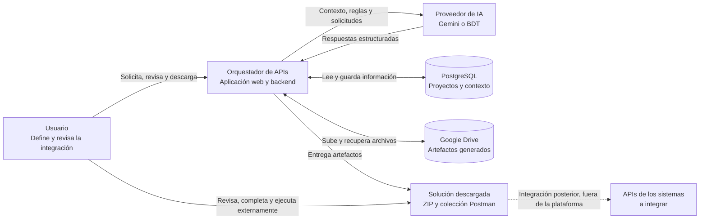
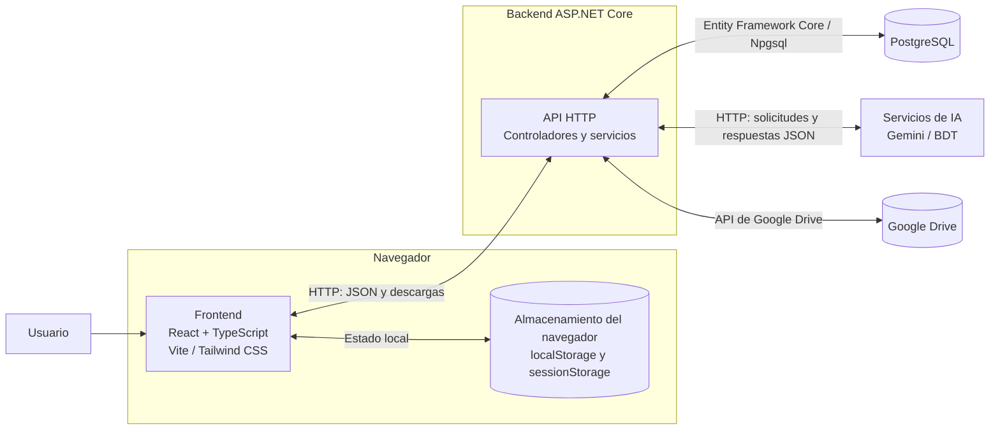
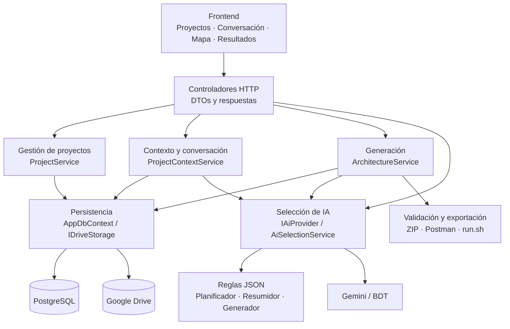
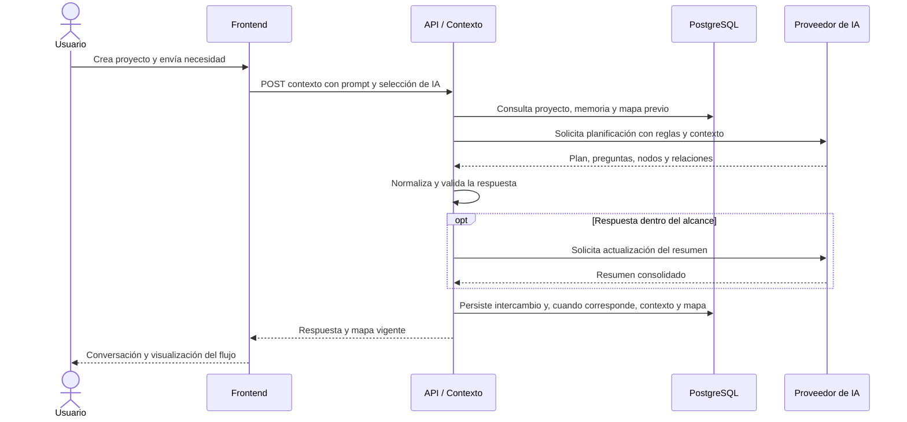
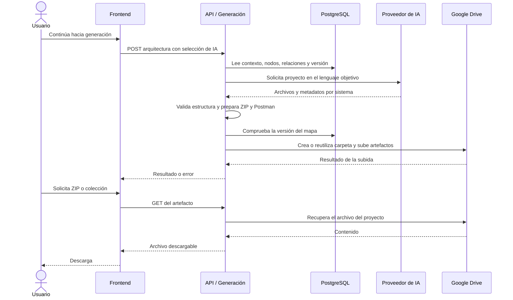
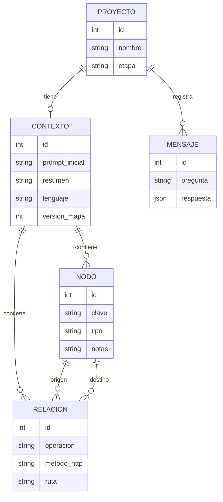

# Documento de arquitectura — Orquestador de APIs

| Dato                   | Descripción                                                                                                                                                     |
| ---------------------- | ---------------------------------------------------------------------------------------------------------------------------------------------------------------- |
| Proyecto               | Orquestador de APIs — Proyecto Final ORT / BDT                                                                                                                  |
| Estado                 | Documento preliminar, sujeto a revisión                                                                                                                         |
| Fecha del relevamiento | 19/11/2026                                                                                                                                                       |
| Base funcional         | ERS - Orquestador de APIs - v2.5                                                                                                                                 |
| Base técnica          | Código local de `docs/introduccion-y-documentacion`; sin diferencias de `frontend` ni `backend` respecto de `develop` local al momento del relevamiento |
| Destinatarios          | Cliente, equipo de desarrollo, referentes técnicos y equipo de continuidad                                                                                      |

> **Criterio de lectura:** este documento describe la organización observada en el código y sus limitaciones. Los requisitos de la ERS son compromisos funcionales, no una confirmación de que estén implementados o probados. Las decisiones pendientes se identifican como tales.
>
> **Referencia a la ERS:** en la versión v2.5 revisada, la modularidad corresponde a **RNF-014**. **RNF-019** se refiere a registros y tratamiento de datos sensibles. Conviene verificar los identificadores si cambia la versión de la ERS.

## 1. Propósito y alcance

El Orquestador de APIs asiste a una persona en la definición de una integración. Recibe una necesidad en lenguaje natural, utiliza un proveedor de IA para proponer y refinar un mapa de sistemas y relaciones, y genera una solución inicial en Python o C# para .NET. También produce una colección Postman y permite descargar los artefactos.

La plataforma **no es un gateway de ejecución**: no opera permanentemente las integraciones generadas ni ejecuta su código como parte de la generación. El resultado requiere revisión y validaciones externas antes de su uso.

El documento cubre componentes, comunicaciones, persistencia, flujos principales, decisiones técnicas observadas y cuestiones para continuidad.

## 2. Vista de contexto

La línea punteada representa el uso posterior de la solución generada; no implica que la plataforma haya probado la conexión con las APIs externas.

## 3. Vista de contenedores

En esta sección, *contenedor* identifica una unidad lógica ejecutable o un almacenamiento; no presupone el uso de Docker.

| Unidad            | Responsabilidad                                                                                            | Ubicación o tecnología                                                            |
| ----------------- | ---------------------------------------------------------------------------------------------------------- | ----------------------------------------------------------------------------------- |
| Frontend          | Navegación, proyectos, conversación, selección de IA, visualización del mapa y descarga de resultados. | [frontend/src](../frontend/src); React, TypeScript, Vite, Tailwind CSS y React Flow. |
| Backend           | Expone la API, coordina planificación, persistencia, generación y exportación.                          | [backend](../backend); ASP.NET Core / .NET 10.                                       |
| PostgreSQL        | Conserva proyectos, contexto, mensajes, nodos y relaciones.                                                | EF Core con proveedor Npgsql y migraciones.                                         |
| Proveedores de IA | Responden solicitudes de planificación, resumen y generación de código.                                 | Integraciones configurables con Gemini y BDT.                                       |
| Google Drive      | Almacena el ZIP, la colección y copias individuales de código generadas.                                 | Acceso del backend mediante la API de Drive y OAuth configurado en el servidor.     |

El backend es una **aplicación desplegable única con módulos internos**, no un conjunto de microservicios independientes. El agente, el generador y el exportador son responsabilidades lógicas del backend, no procesos separados.

En desarrollo, Vite puede reenviar `/api` al backend mediante un proxy. En otros ambientes, la dirección de la API, el transporte y el acceso deben configurarse para ese despliegue. El código contempla CORS para los orígenes configurados; CORS no reemplaza autenticación ni control de acceso.

## 4. Componentes internos

Las flechas representan dependencias lógicas, no necesariamente llamadas HTTP. Dentro del backend, los componentes se comunican mediante llamadas de código e interfaces; la comunicación con IA y Drive utiliza servicios externos.

### 4.1 Presentación

El frontend organiza la experiencia por funcionalidades: proyectos, contexto y conversación, arquitectura propuesta, generación y resultados. Los servicios del frontend realizan solicitudes a la API mediante `fetch`; se manejan estados de carga y error y se utilizan tiempos de espera.

El diagrama se construye con React Flow a partir de nodos y relaciones. **Estado actual:** no permite arrastrar ni conectar nodos, pero sí abrir el detalle de un nodo con un clic y modificar datos desde un modal. Esto difiere de la ERS v2.5, que describe un canvas sin interacción directa y consulta de detalles fuera de él; debe resolverse antes de afirmar conformidad.

La selección de IA se conserva por proyecto y pestaña en `sessionStorage`. El mapa y los turnos con error pueden guardarse en `localStorage`; los turnos con error incluyen el prompt. Esta persistencia del navegador debe considerarse al tratar datos sensibles.

### 4.2 Servicios de plataforma

Los controladores reciben solicitudes, validan sus contratos y delegan la lógica a servicios:

- **Proyectos:** creación, listado con búsqueda y paginación, eliminación y registro de etapa alcanzada.
- **Contexto:** construcción del pedido para el planificador, normalización, actualización de la memoria y persistencia del intercambio y el mapa.
- **Generación:** construcción del pedido al generador, validación estructural de la respuesta, creación de artefactos y coordinación de su almacenamiento.

La aplicación registra la etapa alcanzada del proyecto. La columna `finish_proyect` se calcula a partir de la etapa `generation`.

### 4.3 Agente de IA y selección de proveedor

El agente se implementa como tres responsabilidades que usan el proveedor seleccionado:

1. **Planificador:** interpreta el mensaje, propone estado, preguntas, pasos, nodos y relaciones.
2. **Resumidor:** consolida el contexto para las siguientes interacciones.
3. **Generador:** recibe el contexto y el mapa y devuelve archivos del proyecto y metadatos de los sistemas.

Las instrucciones de cada responsabilidad se cargan desde archivos JSON en [backend/AI/Rules](../backend/AI/Rules). La interfaz `IAiProvider` abstrae el proveedor; `AiSelectionService` valida la selección y delega en el adaptador correspondiente. Gemini usa su API de generación de contenido; BDT utiliza una API compatible con `chat/completions`.

El catálogo se obtiene desde el backend. La disponibilidad publicada se basa en configuración válida, **no en una prueba de conectividad**. Las solicitudes incluyen tiempos de espera y hasta tres intentos ante respuestas HTTP 429 o 5xx; no hay cambio automático de proveedor. Se solicitan respuestas JSON estructuradas y se validan campos de la respuesta, sin que eso garantice la calidad funcional del contenido.

### 4.4 Generación y exportación

El generador recibe el prompt inicial, resumen, lenguaje, plan, supuestos, nodos, notas y relaciones. La IA devuelve una propuesta de archivos y un contexto por sistema; el backend comprueba, entre otros puntos:

- Lenguaje devuelto y correspondencia de los contextos con los nodos `system`.
- Archivos obligatorios, rutas relativas seguras, ausencia de duplicados y conflictos, contenidos y límites de tamaño.
- Existencia del archivo referenciado por cada contexto y límites de código configurados.
- Versión del mapa consultada antes de publicar; si cambió durante la generación, se rechaza esa publicación.

El backend agrega `run.sh` desde una plantilla fija y construye el ZIP y la colección Postman. El ZIP incluye, entre otros, los archivos del proyecto, `README.md`, `USAGE.md`, `nodes.json`, `run.sh`, `.gitignore`, la colección y `.env.example` cuando corresponde. La colección se construye a partir de operaciones HTTP identificadas en el mapa.

Las instrucciones al modelo contemplan mocks locales, pero **su presencia y comportamiento dependen de la respuesta generada** y deben validarse. Los controles estructurales no analizan automáticamente la sintaxis ni garantizan compilación, dependencias correctas o comportamiento. La API no ejecuta ni compila el proyecto generado.

## 5. Flujos principales

### 5.1 Conversación y construcción del mapa

La conversación puede iterarse con nuevos mensajes. Hay manejo de conflicto cuando cambia el contexto durante una operación. La selección de proveedor se envía en cada solicitud; no se supone que una respuesta simulada del frontend pruebe el funcionamiento del proveedor real.

### 5.2 Generación y descarga

Si Drive no está configurado o falla la subida, la generación no se presenta como exitosa. Las subidas se realizan por pasos: no se documenta una transacción atómica entre todos los archivos. El progreso mostrado en el frontend es una **estimación temporal**, no una medición de etapas internas del proveedor.

## 6. Datos y persistencia

### 6.1 Modelo conceptual

El esquema es conceptual: omite campos técnicos y restricciones. El código define un contexto por proyecto, mensajes por proyecto y nodos y relaciones asociados al contexto; las relaciones referencian nodos de origen y destino. Hay restricciones de unicidad para nombres normalizados de proyecto y claves de nodos.

### 6.2 Qué se guarda y dónde

| Ubicación                       | Información principal                                                                                                   | Consideraciones                                                                                                  |
| -------------------------------- | ------------------------------------------------------------------------------------------------------------------------ | ---------------------------------------------------------------------------------------------------------------- |
| PostgreSQL                       | Proyecto y etapa, prompt inicial, resumen, respuestas del planificador, mensajes, nodos, relaciones y versión del mapa. | Contiene información aportada por usuarios. La inicialización aplica migraciones y carga proyectos de ejemplo. |
| Google Drive                     | ZIP, colección Postman y copias individuales de código, en una carpeta derivada del nombre del proyecto.               | Los archivos del mismo nombre se suben o reemplazan; no debe asumirse un historial completo de generaciones.     |
| `localStorage` del navegador   | Mapa y turnos con error, que pueden incluir prompts.                                                                     | Su contenido queda en el navegador; debe contemplarse en privacidad y limpieza.                                  |
| `sessionStorage` del navegador | Selección de proveedor y modelo por proyecto y pestaña.                                                                | La disponibilidad sigue dependiendo de la configuración del backend.                                            |
| Descarga local                   | ZIP, colección Postman y, por separado, exportación Markdown del contexto.                                             | La revisión y custodia posterior son responsabilidad del usuario o del equipo.                                  |

El código generado no se guarda como proyecto fuente en PostgreSQL: se entrega en la respuesta y se almacena como artefacto en Drive. El servicio de eliminación del proyecto borra el registro en base de datos; no se observa allí una eliminación equivalente de la carpeta de Drive. La política de limpieza y retención debe definirse.

## 7. Interfaces principales

Las rutas siguientes resumen los contratos más relevantes; los controladores y DTOs son la referencia técnica para parámetros, respuestas y errores.

| Interfaz HTTP                                              | Uso                                                            |
| ---------------------------------------------------------- | -------------------------------------------------------------- |
| `GET /api/projects` y `POST /api/projects`             | Listar y crear proyectos.                                      |
| `DELETE /api/projects`                                   | Eliminar un proyecto.                                          |
| `GET` y `PATCH /api/projects/{id}/progress`            | Consultar o avanzar la etapa registrada.                       |
| `POST /api/projects/{id}/context`                        | Enviar una interacción al planificador y actualizar contexto. |
| `GET /api/projects/{id}/context/map`                     | Consultar el mapa persistido.                                  |
| `GET /api/projects/{id}/messages`                        | Recuperar el historial de conversación paginado.              |
| `PATCH /api/projects/{id}/context/nodes/{nodeKey}`       | Actualizar notas de un nodo.                                   |
| `GET /api/ai/models`                                     | Obtener proveedores y modelos configurados.                    |
| `POST /api/projects/{id}/architecture`                   | Solicitar generación y publicación de artefactos.            |
| `GET /api/projects/{id}/architecture/package`            | Descargar el ZIP desde Drive a través del backend.            |
| `GET /api/projects/{id}/architecture/postman-collection` | Descargar la colección desde Drive a través del backend.     |

La descarga del contexto como Markdown se arma en el frontend a partir de información recuperada de la API. Las respuestas de error de la API incluyen, según la operación, errores de validación, conflictos de versión, fallas del proveedor o indisponibilidad de Drive.

## 8. Decisiones técnicas observadas y consecuencias

| Decisión observada                                                     | Consecuencia o compromiso                                                                                                                                          |
| ----------------------------------------------------------------------- | ------------------------------------------------------------------------------------------------------------------------------------------------------------------ |
| Frontend separado del backend, con comunicación HTTP.                  | Permite evolucionar presentación y API por separado; requiere coordinar contratos y configuración de despliegue.                                                 |
| Backend único, organizado en controladores, servicios e interfaces.    | Separa responsabilidades sin introducir despliegues distribuidos; los módulos comparten el ciclo de vida de la aplicación.                                       |
| PostgreSQL y EF Core para el estado del proyecto.                       | Permite persistencia relacional y migraciones; el arranque depende de una conexión válida y aplica migraciones.                                                  |
| Adaptadores para Gemini y BDT y reglas de IA en JSON.                   | Aísla parte de las diferencias entre proveedores y permite cambiar instrucciones; incorporar un proveedor o lenguaje adicional requiere desarrollo y validación. |
| Respuestas estructuradas y validación del paquete antes de publicarlo. | Detecta ciertos errores de contrato y estructura; no sustituye compilación ni pruebas funcionales.                                                                |
| Script de arranque desde plantilla del backend.                         | Evita delegar su contenido al modelo; el código de aplicación sigue siendo generado y debe revisarse.                                                            |
| ZIP y Postman en Drive, con descarga intermediada por la API.           | Facilita la entrega; agrega una dependencia externa y una política de retención aún no definida.                                                                |
| Mocks del frontend mediante un plugin de Vite.                          | Permiten desarrollar pantallas sin la API real; no prueban backend, IA ni Drive y son distintos de los mocks que podría generar la solución.                     |

## 9. Seguridad, operación y restricciones

### Configuración y dependencias

- El backend requiere `backend/.env`, conexión PostgreSQL válida y configuración del proveedor de IA elegido. No se incluyen valores ni credenciales en este documento.
- La generación y descarga de artefactos dependen de Google Drive configurado y accesible; sin él se devuelve un error.
- Las reglas de IA deben estar disponibles en el directorio de contenido del backend. El frontend requiere la URL de API y puede usar el proxy de Vite en desarrollo.
- La preparación de la solución descargada puede requerir instalación de dependencias y acceso a sus repositorios. No debe hacerse en el servidor principal sin aislamiento.

### Seguridad y privacidad

- La API no cuenta actualmente con autenticación ni autorización propias. Antes de exponer **backend o frontend** en red, debe definirse e implementar protección adecuada, interna o externa.
- Los prompts y el contexto se envían al proveedor de IA seleccionado. Deben acordarse el tratamiento de datos, permisos, retención y condiciones de uso.
- No debe asumirse detección automática de secretos ni análisis de vulnerabilidades del código generado. Las claves y tokens deben mantenerse fuera del repositorio y de los ejemplos compartidos.
- CORS y la redirección HTTPS configurados en la aplicación no constituyen por sí solos un esquema de autenticación ni garantizan la seguridad del despliegue.

## 10. Verificación y fuentes para continuidad

Existen pruebas automatizadas del frontend y del backend.
Para consultar requisitos, configuración y comandos del proyecto:

- [README general](../README.md).
- [Guía del backend](../backend/README.MD).
- [Guía del frontend](../frontend/README.MD).
- [Reglas de IA](../backend/AI/Rules) y [servicios del backend](../backend/Services).
- [Pruebas del backend](../backend.Tests) y scripts de prueba en [package.json](../frontend/package.json).

Los diagramas utilizan Mermaid. Para visualizarlos en VS Code se necesita una vista previa de Markdown con soporte Mermaid; el contenido textual permanece disponible aun sin ese soporte.
